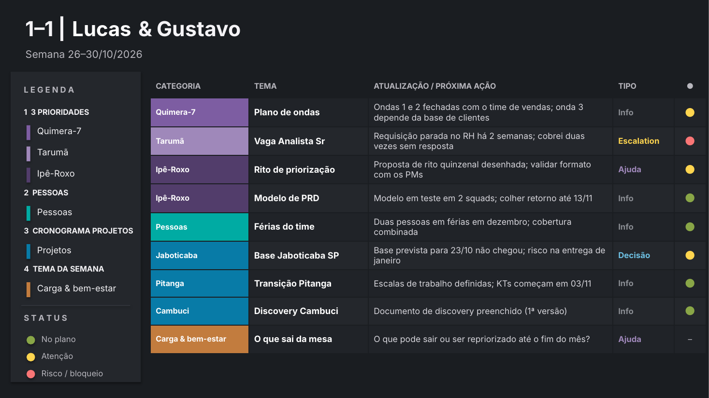
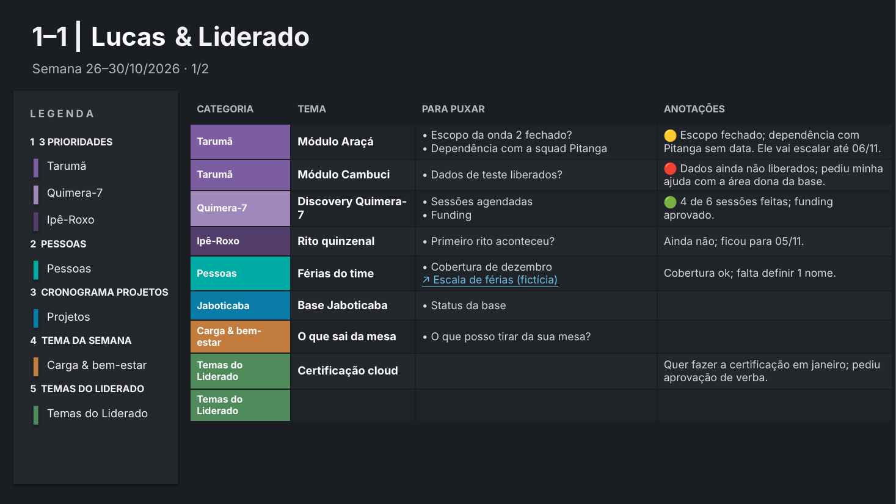

# Organizador de 1:1

Prepara a pauta do seu próximo 1:1, **com o seu gestor ou com alguém do seu time**, e gera o arquivo .pptx no layout padrão.

> **Dados de pessoas.** No Copilot, o agente busca no seu e-mail, no Teams e nas reuniões o que aconteceu desde o último 1:1. Use num ambiente aprovado pela sua empresa. Veja o [aviso do módulo](../README.md).

## O que ele faz

1. **Você diz** com quem é o 1:1, as prioridades da vez e anexa a pauta anterior (.pptx, imagem ou texto).
2. **Ele busca o que aconteceu desde o último 1:1** e propõe a pauta: as 3 prioridades, Pessoas, Projetos e o tema da semana, que roda entre Metas & PDP, Carreira, Feedback mútuo e Carga & bem-estar.
3. **Com o gestor,** cada linha traz atualização, tipo (Info, Ajuda, Escalation ou Decisão) e status.
4. **Com alguém do time,** cada linha traz pontos para puxar o assunto, espaço para anotar e para os temas que a pessoa trouxer. As anotações viram a base da pauta seguinte.
5. **Combinados** ficam num bloco próprio e voltam toda semana até você marcar como feitos.
6. **Depois da sua revisão,** entrega a tabela e o .pptx.

## Como usar

### No Microsoft 365 Copilot

1. **Baixe as 3 skills** da pasta [`skills-zip/`](skills-zip/): `pauta-1-1`, `pauta-1-1-temas` e `pauta-1-1-pptx`.
2. Crie um agente novo e, na aba **Configurar**, preencha:
   - **Nome:** `Organizador de 1-1`.
   - **Descrição, instruções e prompts iniciais:** copie do [`agente.md`](agente.md).
   - **Conhecimento:** seus e-mails, chats e reuniões do Teams, as pessoas da organização, e seu OneDrive e SharePoint.
   - **Capacidades:** ligue o **interpretador de código**, que roda o script da pauta.
   - **Skills:** suba os 3 .zip.
3. Se aparecerem, ligue a opção de usar só as fontes configuradas e escolha o modo de resposta que pensa mais antes de responder (*Think deeper*).
4. **Primeiro uso:** anexe a pauta anterior e escreva *"Quero preparar meu 1-1 com o meu gestor."*

### No Claude

Suba os 3 .zip como skills e cole as instruções num projeto. Sem a busca no e-mail e no Teams, a pauta sai do que você anexar e contar.

## Status

| Versão | Situação |
|---|---|
| 1.3.0 | Em uso pelo autor desde a 1.0.0. Na 1.3.0, o código do .pptx passou para um script, sem mudar o resultado: os slides saem idênticos aos da 1.2.0. O código passa na conferência automática ([`testes/conferir_codigo.py`](testes/conferir_codigo.py)) |

## Arquivos desta pasta

| Arquivo | Para quê |
|---|---|
| [`agente.md`](agente.md) | Instruções, descrição e prompts iniciais, prontos para copiar |
| [`skills-zip/`](skills-zip/) | As 3 skills empacotadas, prontas para subir |
| [`pacote/`](pacote/) | O agente como o Copilot exporta |
| [`referencias/`](referencias/) | Imagens dos dois layouts, com dados fictícios |
| [`fixtures/`](fixtures/) | Duas pautas anteriores fictícias, para testar |
| [`NOTAS.md`](NOTAS.md) | Desenho, decisões e casos de teste |
| [`testes/`](testes/) | A conferência automática do script |
